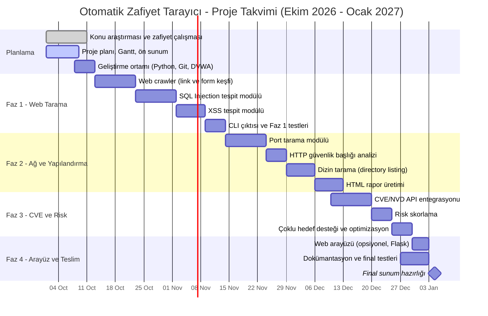

# Gantt Şeması — Otomatik Zafiyet Tarayıcı

## Görev Tablosu

| Faz | Görev | Başlangıç | Süre | Çıktı |
|-----|-------|-----------|------|-------|
| Planlama | Konu araştırması | 1 Eki | 10 gün | Zafiyet rehberi |
| Planlama | Plan, Gantt, ön sunum | 1 Eki | 8 gün | Ön sunum |
| Planlama | Ortam kurulumu | 8 Eki | 5 gün | Python, Git, DVWA hazır |
| Faz 1 | Crawler | 13 Eki | 10 gün | URL/form listesi |
| Faz 1 | SQLi modülü | 23 Eki | 10 gün | SQLi tespiti |
| Faz 1 | XSS modülü | 2 Kas | 7 gün | XSS tespiti |
| Faz 1 | CLI + test | 9 Kas | 5 gün | Faz 1 teslimi |
| Faz 2 | Port tarama | 14 Kas | 10 gün | Açık port/servis listesi |
| Faz 2 | Başlık analizi | 24 Kas | 5 gün | Eksik başlık raporu |
| Faz 2 | Dizin tarama | 29 Kas | 7 gün | Dizin bulguları |
| Faz 2 | HTML rapor | 6 Ara | 7 gün | Faz 2 teslimi |
| Faz 3 | CVE entegrasyonu | 10 Ara | 10 gün | CVE eşleştirme |
| Faz 3 | Risk skorlama | 20 Ara | 5 gün | Düşük/Orta/Yüksek/Kritik |
| Faz 3 | Çoklu hedef | 25 Ara | 5 gün | Faz 3 teslimi |
| Faz 4 | Arayüz (opsiyonel) | 30 Ara | 4 gün | Flask arayüzü |
| Faz 4 | Dokümantasyon, test | 27 Ara | 7 gün | Final raporu |

> **Risk notu:** Zaman yetmezse Faz 4 (arayüz) ve Faz 3'teki çoklu hedef desteği çıkarılabilir. Çekirdek hedef Faz 1 ve Faz 2'dir.
