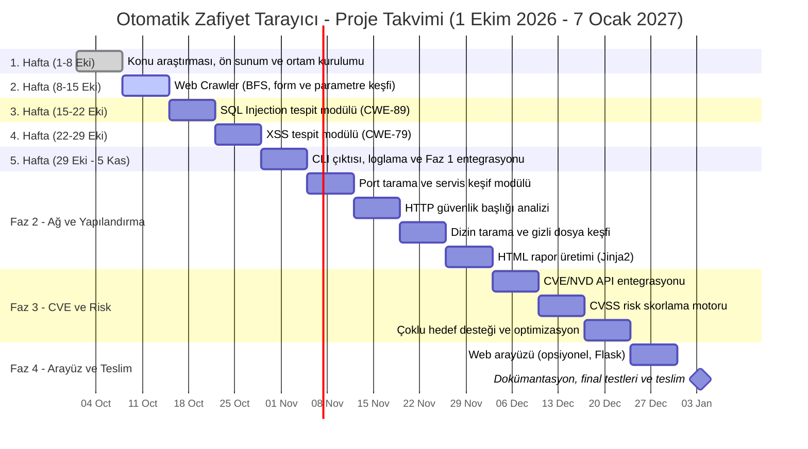

# Gantt Şeması — Otomatik Zafiyet Tarayıcı

> **Not:** Proje **1 Ekim 2026** tarihinde başlamıştır. Danışman Prof. Dr. Ercan BULUŞ ile her **Perşembe** günü (1, 8, 15, 22, 29 Ekim...) düzenli haftalık ilerleme ve değerlendirme toplantısı gerçekleştirilmektedir.

## Haftalık Toplantı ve Görev Tablosu (Her Perşembe Toplantı)

| Hafta | Tarih Aralığı | Perşembe Toplantı Tarihi | İş Paketi / Görev | Durum / Çıktı |
|:---:|:---:|:---:|:---|:---|
| **1. Hafta** | 1 – 8 Ekim 2026 | **8 Ekim 2026** | Konu araştırması, ön proje planı, ön sunum ve ortam kurulumu (Python, Git, DVWA) | **Tamamlandı** (Ön Sunum & Ön Rapor teslim edildi) |
| **2. Hafta** | 8 – 15 Ekim 2026 | **15 Ekim 2026** | **Faz 1: Web Crawler İleri Geliştirmeleri** (BFS, `collections.deque`, `max_depth`, `InputField`, `ParamURL`, `robots.txt`, DVWA testleri) | **Tamamlandı** (2. Hafta Raporu & Sunumu hazır) |
| **3. Hafta** | 15 – 22 Ekim 2026 | **22 Ekim 2026** | **Faz 1.2: SQL Injection (CWE-89) Tespit Modülü** (Hata tabanlı testler, regex veritabanı) | Sırada |
| **4. Hafta** | 22 – 29 Ekim 2026 | **29 Ekim 2026** | **Faz 1.3: Cross-Site Scripting (CWE-79) Tespit Modülü** (Reflected & Stored XSS) | Planlandı |
| **5. Hafta** | 29 Ekim – 5 Kasım | **5 Kasım 2026** | **Faz 1.4: CLI Arayüzü, Loglama ve Faz 1 Entegrasyon Testleri** | Planlandı |
| **6. Hafta** | 5 – 12 Kasım 2026 | **12 Kasım 2026** | **Faz 2: Port Tarama ve Ağ Analiz Modülü** (python-nmap / socket) | Planlandı |
| **7. Hafta** | 12 – 19 Kasım 2026 | **19 Kasım 2026** | **Faz 2.2: HTTP Güvenlik Başlıkları Analizi** (CSP, HSTS, X-Frame-Options) | Planlandı |
| **8. Hafta** | 19 – 26 Kasım 2026 | **26 Kasım 2026** | **Faz 2.3: Dizin Tarama (Directory Listing) ve Hassas Dosya Keşfi** | Planlandı |
| **9. Hafta** | 26 Kasım – 3 Aralık | **3 Aralık 2026** | **Faz 2.4: HTML Rapor Üretimi (Jinja2) ve Faz 2 Teslimi** | Planlandı |
| **10. Hafta**| 3 – 10 Aralık 2026 | **10 Aralık 2026**| **Faz 3: CVE ve NVD API Entegrasyonu** (Zafiyet Eşleştirme) | Planlandı |
| **11. Hafta**| 10 – 17 Aralık 2026| **17 Aralık 2026**| **Faz 3.2: CVSS Tabanlı Otomatik Risk Skorlama** | Planlandı |
| **12. Hafta**| 17 – 24 Aralık 2026| **24 Aralık 2026**| **Faz 3.3: Çoklu Hedef Desteği ve Performans Optimizasyonu** | Planlandı |
| **13. Hafta**| 24 – 31 Aralık 2026| **31 Aralık 2026**| **Faz 4: Web Arayüzü (Opsiyonel / Flask)** | Planlandı |
| **14. Hafta**| 31 Aralık – 7 Ocak | **7 Ocak 2027**  | **Proje Final Raporu, Kapanış Sunumu ve Kod Teslimi** | Final Teslimi |

> **Risk Yönetimi:** Zaman kısıtı durumunda Faz 4 (Web Arayüzü) opsiyoneldir. Projenin çekirdek başarı kriteri Faz 1 ve Faz 2 iş paketleridir.
